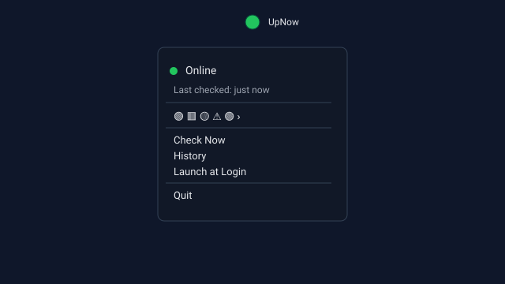

## UpNow

UpNow is a tiny, privacy‑friendly macOS menu bar app that shows whether you’re online, offline, or need to sign in to a captive portal — at a glance.

- Clear icon in the menu bar (color + shape)
- Status, latency and when it last checked, in one line
- History of recent outages and how long they lasted
- A heads-up when you're on a hotspot or a weak power source
- Colorblind-friendly colors and Launch at Login, under Settings

## Screenshot

## Install
1. Download `UpNow.zip` from the [latest release](https://github.com/simonwisdom/upnow/releases/latest).
2. Unzip it and drag `UpNow.app` into Applications.
3. Open it. The first time, macOS says it can't verify the app: open System Settings → Privacy & Security, scroll down and click **Open Anyway**.

Requires macOS 13 (Ventura) or later.

## Privacy
- No analytics or telemetry.
- Connectivity checks fetch the standard captive-portal endpoints `captive.apple.com/hotspot-detect.html` and `www.gstatic.com/generate_204`.

## Build from source
Open `UpNow.xcodeproj` in Xcode 15+, select the `UpNow` scheme and Run. App source lives in `swiftui-app/`; see `swiftui-app/README.md` for implementation notes.

## License
MIT — see `LICENSE`.
